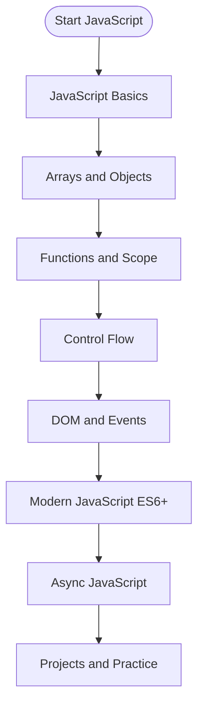

# JavaScript Practice

<p align="center">
  <b>My JavaScript Learning Journey</b><br>
  Learning JavaScript through daily practice, examples, and coding exercises.
</p>

<p align="center">
  
  
  
</p>

---

## About This Repository

Welcome to my JavaScript Practice repository!

This repository contains my JavaScript learning journey, where I practice concepts, write code examples, solve problems, and improve my programming skills step by step.

My goal is to build a strong foundation in JavaScript and understand how things work through practical coding.

## Learning Roadmap

The following flowchart represents my JavaScript learning path.



## Repository Structure

```text
JavaScript-Practice/
│
├── 01_basics/
│   ├── 01_variables.js
│   ├── 02_dataTypes.js
│   ├── 03_conversionOperation.js
│   ├── 04_stack_heap.js
│   ├── 05_comparison.js
│   ├── 06_strings.js
│   ├── 07_numAndMath.js
│   └── 08_dateAndTime.js
│
├── 02_basics/
│   ├── 01_arrays.js
│   ├── 02_arrays.js
│   ├── 03_object.js
│   └── 04_objects.js
│
├── 03_basics/
│   ├── 01_functions.js
│   ├── 02_scopes.js
│   ├── 03_advanced.js
│   └── 04_iife.js
│
├── 04_control_flow/
│   ├── 01_conditionals.js
│   ├── 02_truthy_falsy.js
│   ├── 03_loops.js
│   └── 04_control_statements.js
│
└── README.md
```

## Technologies Used

- JavaScript
- Node.js
- Visual Studio Code
- Git and GitHub

## My Learning Goals

- Build strong JavaScript fundamentals.
- Improve problem-solving skills.
- Understand concepts through practical examples.
- Learn modern JavaScript (ES6+).
- Move towards React and MERN Stack development.

## Author

**Prathviraj Chouhan**

B.Tech Computer Science Student | Learning JavaScript and MERN Stack

[GitHub Profile](https://github.com/prathviraj29)

---

<p align="center">
  <i>Learning step by step, improving every day.</i>
</p>
